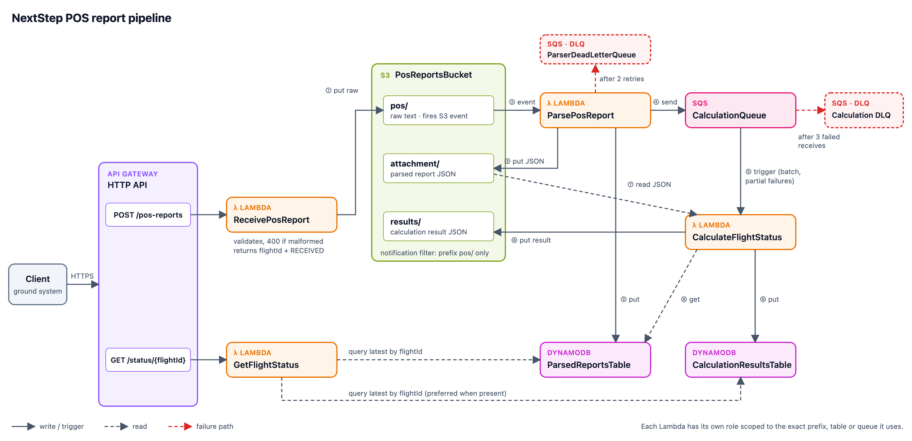

# NextStep POS Reports – Cloud Backend

A serverless pipeline on AWS that receives aircraft **position reports (POS reports)** over HTTP, stores the raw message,
parses it into a structured record, calculates the remaining flight time and estimated fuel at arrival, and lets callers
check a flight's status at any time.

- **Lambdas:** C# / .NET 8 (arm64)
- **Infrastructure:** AWS CDK v2 in TypeScript, deployable with `cdk deploy`
- **AWS services:** API Gateway (HTTP API), Lambda, S3, DynamoDB, SQS

---

## Contents

1. [How it works](#how-it-works)
2. [API](#api)
3. [Repository layout](#repository-layout)
4. [Prerequisites](#prerequisites)
5. [Build and test locally](#build-and-test-locally)
6. [Deploy](#deploy)
7. [Test the deployed stack](#test-the-deployed-stack)
8. [Design decisions and trade-offs](#design-decisions-and-trade-offs)
9. [Failure handling](#failure-handling)
10. [Assumptions](#assumptions)

---

## How it works



<sub>Editable source: [docs/architecture.svg](docs/architecture.svg)</sub>

| Step | Component | What happens |
|---|---|---|
| ① | **ReceivePosReport** Lambda (`POST /pos-reports`) | Validates the report (400 if malformed), builds the `flightId`, stores the raw text at `pos/{flightId}-{receivedAt}` and returns `{ flightId, status: "RECEIVED" }` immediately. |
| ② | S3 event notification | Fires for new objects **under `pos/` only** and invokes the parser. |
| ③ | **ParsePosReport** Lambda | Parses the report, writes the structured JSON to `attachment/{flightId}-{reportTimestamp}.json` and a record to the **ParsedReports** table. |
| ④ | **ParsePosReport** Lambda | Sends `{ flightId, timestamp }` to the **CalculationQueue**. |
| ⑤–⑨ | **CalculateFlightStatus** Lambda (SQS trigger) | Looks up the parsed record, reads its attachment, calculates distance (haversine), remaining time and fuel at arrival, writes the result to `results/{flightId}-{calculatedAt}.json` and a record to the **CalculationResults** table. |
| – | **GetFlightStatus** Lambda (`GET /status/{flightId}`) | Returns the latest calculation for the flight. If none exists yet it returns the latest parsed report (`PARSED`), otherwise 404. |

Because the pipeline is asynchronous, a status lookup right after submitting may return `PARSED` or 404 for a
moment. That is expected, not an error.

### Example

The report `POS/UL204.FR RGN/TO BKK/041205/N1642.3E09612.5/450/12500/2800`, received at `2026-09-04T15:12:30.123Z`, produces:

| Artifact | Value |
|---|---|
| `flightId` | `UL20420260904RGNBKK` |
| Raw object | `pos/UL20420260904RGNBKK-2026-09-04T15:12:30.123Z` |
| Attachment | `attachment/UL20420260904RGNBKK-2026-09-04T12:05:00Z.json` (lat `16.705`, lon `96.2083`, …) |
| Result | ≈ 319 NM to BKK → **43 min** remaining, **10513 kg** fuel at arrival, no low-fuel warning |

---

## API

The base URL is the `ApiUrl` stack output (see [Deploy](#deploy)).

### `POST /pos-reports`

Body: the raw POS report as plain text.

```bash
curl -X POST "$API_URL/pos-reports" -H 'Content-Type: text/plain' \
  --data 'POS/UL204.FR RGN/TO BKK/041205/N1642.3E09612.5/450/12500/2800'
```

| Status | Body |
|---|---|
| `202 Accepted` | `{"flightId":"UL20420260904RGNBKK","status":"RECEIVED"}` |
| `400 Bad Request` | `{"message":"The POS report must have 8 '/'-separated parts but has 3."}` |

### `GET /status/{flightId}`

```bash
curl "$API_URL/status/UL20420260904RGNBKK"
```

| Status | Body |
|---|---|
| `200` (calculated) | `{"flightId":"UL20420260904RGNBKK","status":"CALCULATED","timestamp":"2026-09-04T12:06:15.842Z","remainingFlightTimeMinutes":43,"estimatedFuelAtArrivalKg":10513,"lowFuelWarning":false}` |
| `200` (not calculated yet) | `{"flightId":"UL20420260904RGNBKK","status":"PARSED","timestamp":"2026-09-04T12:05:00Z"}` |
| `404` | `{"message":"No status found for flight 'UL20420260904RGNBKK'."}` |

`status` is one of `PARSED`, `CALCULATED` or `LOW_FUEL_WARNING` (estimated fuel at arrival is negative).
`timestamp` is the calculation time once calculated, otherwise the POS report time.

---

## Repository layout

```
├── src/
│   ├── NextStep.PosReports.Domain/          Pure business logic, no AWS dependencies
│   │   ├── Parsing/        PosReportParser, CoordinateParser
│   │   ├── Calculation/    GreatCircle (haversine), FlightEstimator
│   │   ├── Airports/       AirportDirectory (hardcoded code → coordinates)
│   │   ├── Identifiers/    FlightIdentifier, ObjectKeys (S3 key conventions)
│   │   ├── Models/         PosReport, FlightCalculationResult, FlightStatus
│   │   └── Time/           UtcTimestamp formats and JSON converters
│   ├── NextStep.PosReports.Infrastructure/  AWS adapters behind interfaces (S3, DynamoDB, SQS, API responses)
│   └── Lambdas/                             One project per function, each a thin handler
│       ├── NextStep.PosReports.Lambda.ReceivePosReport/
│       ├── NextStep.PosReports.Lambda.ParsePosReport/
│       ├── NextStep.PosReports.Lambda.CalculateFlightStatus/
│       └── NextStep.PosReports.Lambda.GetFlightStatus/
├── tests/
│   ├── NextStep.PosReports.Domain.Tests/    Parser, coordinates, haversine, keys, edge cases
│   └── NextStep.PosReports.Lambda.Tests/    Handlers with mocked adapters (NSubstitute)
├── aws/                                     CDK app (TypeScript)
│   ├── bin/pos-reports-app.ts               Entry point
│   ├── lib/pos-reports-stack.ts             The stack
│   ├── lib/constructs/dotnet-function.ts    .NET Lambda construct with a log-only base role
│   └── test/                                Template assertions (Jest)
├── integration/                             End-to-end tests against a deployed stack (Jest)
├── scripts/
│   ├── build-lambdas.sh                     dotnet publish → cdk.artifacts/
│   └── smoke-test.sh                        Quick manual check of a deployment
├── docs/                                    Architecture diagram
├── NextStep.PosReports.CloudBackend.sln
├── Directory.Build.props / Directory.Packages.props   Shared .NET settings, central package versions
└── cdk.json, package.json, tsconfig.json, jest*.config.js
```

`cdk.artifacts/`, `cdk.out/` and `cdk.outputs/` are generated and git-ignored.

---

## Prerequisites

| Tool | Version | Check |
|---|---|---|
| .NET SDK | 8.0.4xx | `dotnet --version` |
| Node.js | 22 or later | `node --version` |
| AWS CLI | v2 | `aws --version` |

Docker is **not** required: the Lambdas are built with `dotnet publish`.

The CDK CLI is installed locally by `npm ci`, so use `npx cdk …` or the npm scripts below.

---

## Build and test locally

No AWS account is needed for any of this.

```bash
npm ci                    # CDK, TypeScript and test tooling
npm test                  # all local tests: .NET (xUnit) + CDK (Jest)
```

Or separately:

```bash
dotnet test               # Domain and Lambda handler tests
npm run test:cdk          # CDK template assertions
npm run typecheck         # TypeScript type check
npm run synth             # build the Lambda packages and synthesize the CloudFormation template into cdk.out/
```

The CDK tests check, among other things, that the S3 notification is limited to `pos/`, that the queue has a DLQ, and
that **no IAM statement in the template uses a wildcard action or `Resource: "*"`**.

---

## Deploy

### 1. One-time setup per AWS account and region

```bash
aws configure sso         # or: aws login / aws configure
aws sts get-caller-identity
npx cdk bootstrap aws://<ACCOUNT_ID>/<REGION>
```

The stack deploys to the account and region of your active AWS CLI profile (`CDK_DEFAULT_ACCOUNT` / `CDK_DEFAULT_REGION`).
To target another region: `AWS_REGION=eu-west-1 npm run deploy`.

### 2. Deploy

```bash
npm ci
npm run deploy
```

This publishes the four Lambdas to `cdk.artifacts/`, runs `cdk deploy`, and writes the stack outputs
(`ApiUrl`, `BucketName`, table names, queue URLs) to `cdk.outputs/outputs.json`. CDK asks you to confirm the IAM changes.

```bash
export API_URL=$(node -p "require('./cdk.outputs/outputs.json').NextStepPosReports.ApiUrl")
```

Other commands: `npm run diff` (preview changes) and `npm run destroy` (removes **everything**, including stored reports).

### Logs

Each function logs JSON to its own CloudWatch log group (2-week retention). Find them via the Lambda console →
function → *Monitor* → *View CloudWatch logs*, or:

```bash
aws logs tail /aws/lambda/<function-name> --follow
```

Logs cover important events and errors only: report received or rejected, report parsed, flight calculated,
low-fuel warning, and failures (with the flight id or message id).

---

## Test the deployed stack

```bash
npm run smoke-test        # submits the example report and polls the status until it is calculated
npm run test:integration  # full end-to-end suite (~5 minutes, see below)
```

The integration tests (`integration/`) read `cdk.outputs/outputs.json` and use your AWS credentials to check what
the pipeline stored. They cover:

- **Validation:** malformed reports return 400 with a reason; an unknown flight returns 404.
- **Happy path:** the specification example through every stage (raw object, attachment, both tables, result
  object, status API) with the exact expected values.
- **Low fuel:** a report without enough fuel is marked `LOW_FUEL_WARNING`.
- **Several reports per flight:** the status is the most recent calculation.
- **Failure path:** a report the calculator cannot process ends up in the dead-letter queue, and the flight stays
  `PARSED`. This one waits for 3 delivery attempts × 90 s visibility timeout, which is why the suite takes ~5 minutes.
  Run just the fast suites with `npx jest -c jest.integration.config.js api-validation pipeline`.

Each run uses random flight numbers, so runs don't interfere with each other or with existing data.

---

## Design decisions and trade-offs

**Pure domain, thin handlers.** All parsing and calculation logic lives in `Domain` with no AWS dependencies and is
unit-tested in isolation. Handlers only orchestrate. AWS access goes through small interfaces (`IObjectStorage`,
`I…Repository`, `ICalculationRequestPublisher`), so handlers are tested with mocks and a `FakeTimeProvider`.

**One project per Lambda.** Each function ships only its own handler plus the shared libraries, can be deployed and
reasoned about independently, and gets its own IAM role.

**Full validation at the API.** The spec asks for a "roughly well-formed" check. The API runs the full parser
instead and returns a specific 400 reason. The cost is negligible, the caller gets immediate feedback, and malformed
reports never enter the pipeline. Both the API and the parser use the same parser code, so they can't disagree.

**The receive time drives the flight date.** The report only has day/hour/minute, so year and month come from the
moment the API received it. The parser takes that time **from the S3 key**, not from its own clock, so the `flightId`
it writes always matches the one the API returned, even if parsing happens after midnight at month end.

**Status reads only DynamoDB.** The calculation-results item carries the headline figures (`status`,
`remainingFlightTimeMinutes`, `estimatedFuelAtArrivalKg`, `lowFuelWarning`) in addition to the spec's
`flightId`/`timestamp`/`attachment`. The status endpoint is therefore two cheap queries (`ScanIndexForward=false, Limit=1`)
with no S3 reads, and its role needs no S3 permissions at all. The full self-contained result stays in S3.

**Least-privilege IAM, enforced by tests.** Every permission is an explicit statement scoped to one S3 prefix, table or
queue (for example, the receive function can only `s3:PutObject` on `pos/*`). The functions don't use the standard
`AWSLambdaBasicExecutionRole`, because it allows writing to any log group. Each function's role can only write to its
own log group. The two helper roles CDK creates internally (bucket notifications, auto-delete objects) use AWS's
standard basic execution policy.

**Timestamps as sortable strings.** Report times use second precision (`2026-09-04T12:05:00Z`). System times
(receive, calculation) use millisecond precision (`…T15:12:30.123Z`), matching the spec. Each table only ever holds
one format, so lexical order is chronological order for the sort key.

**HTTP API instead of REST API.** It's cheaper and simpler, and covers both routes. Request validation is done in
the Lambda anyway.

**202 Accepted** for `POST /pos-reports`: the report is accepted for asynchronous processing, not yet processed.

**Build without Docker.** `dotnet publish -r linux-arm64` produces the packages directly, and arm64 (Graviton) is
cheaper for Lambda. The trade-off is that the build is not containerized, so it relies on the local .NET SDK version
pinned in `global.json`.

**Disposable by default.** The bucket and tables use `RemovalPolicy.DESTROY` (with auto-delete of objects) so
`cdk destroy` leaves nothing behind. For production this would be `RETAIN` plus point-in-time recovery and versioning.

**Not included (out of scope for this assessment):** API authentication (IAM/JWT authorizer), API throttling
limits, alarms on DLQ depth, and X-Ray tracing. These would be the next additions for production use.

---

## Failure handling

| Situation | Behaviour |
|---|---|
| Malformed report | `400` with a reason. Nothing is stored. |
| AWS error in `POST /pos-reports` | The Lambda fails and the caller gets `500` and can safely resubmit. |
| Parser fails (e.g. S3/DynamoDB/SQS error) | S3 invokes the parser asynchronously. Lambda **retries twice**, then sends the event (with the error) to **ParserDeadLetterQueue** (14-day retention). Every parser step writes to deterministic keys, so retries are idempotent. |
| Calculator fails for one message | The handler reports a **partial batch failure**: only that message returns to the queue. It is retried after the 90 s visibility timeout (6× the 15 s function timeout). |
| Message keeps failing | After **3 receives** SQS moves it to the **Calculation DLQ** (14-day retention). Nothing is lost or retried forever. After fixing the cause, replay with `aws sqs start-message-move-task --source-arn <DLQ ARN>`. |
| Unknown destination airport | A permanent error: it fails all 3 attempts and lands in the Calculation DLQ. The flight stays `PARSED`, and an error is logged with the message body. |
| Duplicate delivery (S3 and SQS are at-least-once) | The parser overwrites the same attachment and record. The calculator may write one extra result row, and the status endpoint still returns the latest one. |

---

## Assumptions

- **Position format** follows the example and table in the spec: the hemisphere letter comes *before* the digits
  (`N1642.3E09612.5`). Latitude has 2 degree digits, longitude 3, and minutes are decimal and must be < 60.
- **Decimal degrees are rounded to 4 places** (≈ 11 m), which reproduces the spec's `96.2083`.
- **Year and month come from the receive time in UTC.** A report timed on the last day of a month but received after
  midnight UTC on the 1st gets the new month (and is rejected if that day doesn't exist in the new month). Inferring
  the previous month would need a heuristic the spec doesn't define.
- **Flight number:** 2-character IATA airline designator + 1–4 digits + optional letter suffix (e.g. `UL204`, `9W123`).
  Airport codes are 3 upper-case letters.
- **Ground speed** must be > 0 (it is a divisor). Fuel on board and fuel flow are whole kilograms ≥ 0.
- **Destination airports** are validated only by the calculator, against the hardcoded directory in
  `AirportDirectory.cs` (RGN, BKK, SIN, KUL, HKG, DEL, SYD, LHR, JFK). Add entries there to support more.
- **Rounding:** remaining minutes and fuel at arrival are rounded half away from zero. The low-fuel flag is based on
  the unrounded value.
- **"Most recent status"** means the latest calculation by calculation time. A flight shows `PARSED` only until its
  first calculation finishes.
